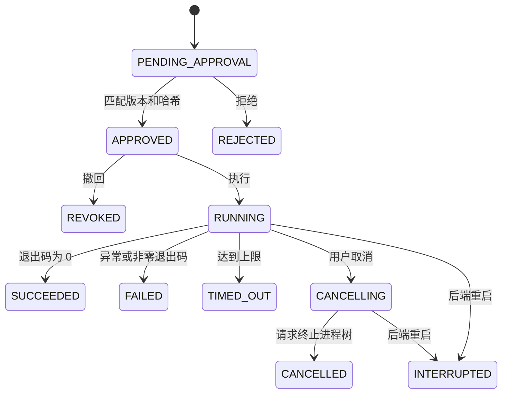

# 任务计划、审批与执行

本页描述 2026-10-20 新增代码契约。是否通过运行验收以 [当前状态](../agent/STATUS.md) 为准。

## 使用流程

1. 在项目管理中登记目录并选择 Maven `pom.xml`。
2. 打开任务执行页，为项目保存 JDK 根目录、Maven 根目录与 Maven 依赖缓存绝对路径。配置只保存到 DevMate 数据库，不修改系统环境或项目文件。
3. 选择打包、验证或启动现有 JAR，填写目标后生成计划。可勾选让模型选择动作，此时只把目标发给已配置模型，模型必须返回一个动作枚举。
4. 查看实际参数数组、工作目录、环境覆盖、风险、文件摘要和验证标准；批准具体版本。批准和执行是两次独立操作，批准后也可以撤回。
5. 点击执行后查看状态与日志；需要停止时取消。失败、超时、拒绝、撤回或重试都不会自动复用审批，必须生成新的计划。

Maven 计划使用指定 JDK 直接调用 Maven 的 Java 入口，不经过 Shell 或 Wrapper。`package`、`verify` 均不跳过测试。启动计划必须指定所选模块 `target` 下已存在的 JAR；需要先完成构建，再创建启动计划。

## 程序校验与审批边界

`PlanRequest` 接受项目 ID、候选 POM、目标、动作、JAR 相对路径和是否使用模型。可接受的动作只有 `MAVEN_PACKAGE`、`MAVEN_VERIFY`、`JAVA_JAR`。模型不能提供可执行文件、路径、命令或参数。POM 必须属于重新发现的候选，JAR 不能越过模块边界，真实路径检查阻止链接指向项目外。

服务端生成不可变的 `ExecutionPlan`，包含参数数组、工作目录、子进程环境、输入摘要、时间上限、风险与验证标准。每条任务是一个不可变的第 1 版计划；重新生成会创建新任务 ID，不覆盖已审批记录。计划 JSON 的 SHA-256 和版本必须同时匹配，状态也必须为待审批。审批与执行前会重新检查所选 POM、Java 启动器以及 Maven 引导文件或目标 JAR 的 SHA-256。

摘要不冻结整个仓库、Maven 全部库、插件或外部依赖，也不构成操作系统沙箱。构建会执行项目插件和测试，启动会运行项目代码；二者都可能访问网络、文件或数据库。用户需要审阅计划风险并确认项目来源可信。系统只覆盖子进程的 `JAVA_HOME`，清除继承的 JVM 注入选项，不写全局环境变量。

## 状态与恢复

状态更新用数据库条件更新防止重复审批和重复启动。每个项目同时只能运行一个任务，全局最多两个。构建上限 15 分钟；JAR 上限 24 小时。取消和正常关闭会请求终止 DevMate 创建的进程及其当时可见的后代，不查找或停止其他用户进程。后端异常退出后仅把运行记录标为中断，不自动重试；需手动检查可能遗留的进程。

日志按序号保存，`after` 游标每次最多读取 200 块。每个任务最多保存 1 MiB 字符输出，之后仍持续排空管道以免进程阻塞。页面每两秒轮询，导出按钮导出当前已加载的内容。日志可能包含项目自身输出的敏感内容，当前没有提供跨用户共享入口。

“进程运行中”只表示已启动，“成功”只表示进程以 0 退出；当前不声称 HTTP 健康验证通过。

## HTTP 接口

| 接口 | 作用 |
|---|---|
| `GET/PUT /api/v1/projects/{id}/environment` | 读取/保存项目工具绑定 |
| `GET/POST /api/v1/tasks` | 最近 200 条记录/生成计划 |
| `GET /api/v1/tasks/{id}` | 单条计划、审批和执行状态 |
| `POST /api/v1/tasks/{id}/approve` | 提交 `{version, contentHash}` |
| `POST /api/v1/tasks/{id}/reject` | 拒绝待审批计划 |
| `POST /api/v1/tasks/{id}/revoke` | 撤回尚未执行的审批 |
| `POST /api/v1/tasks/{id}/execute` | 启动已审批计划 |
| `POST /api/v1/tasks/{id}/cancel` | 取消运行中的任务 |
| `GET /api/v1/tasks/{id}/logs?after=0` | 按游标读取日志 |
| `GET/POST /api/v1/agent/conversations` | 会话列表/创建固定项目上下文会话 |
| `GET/POST /api/v1/agent/conversations/{id}/messages` | 消息与轨迹历史/发送消息 |

会话保存在 SQLite，模型使用最近六轮文本上下文，历史助手答复每条最多 8000 字符；不把旧工具调用当成新工具事实。每个会话最多 100 轮，同会话不能并发发送。调用失败不写入不完整的问答对。

## 后续范围

当前只支持单动作计划。多步骤部署、工具下载/安装、Git 克隆、Java 版本兼容检查、端口和健康接口验证、真实日志的 Agent 诊断、配置备份/修改/恢复仍需后续实现。V1 全功能与端到端验收尚未完成。
